# System Design Handbook

```mermaid
flowchart LR
    title["System Design Series"]

    subgraph foundations["1 - Foundations"]
        direction LR
        what["What is System Design"] --> components["Components"] --> intensive["Data vs Compute Intensive"] --> requirements["Functional & Non-Functional"]
    end

    subgraph communication["2 - Communication"]
        direction LR
        dns["DNS"] --> apis["APIs"] --> rest["REST in Detail"]
    end

    subgraph data["3 - Data Layer"]
        direction LR
        sql["SQL"] --> nosql["NoSQL"] --> cache["Cache"]
    end

    subgraph scaling["4 - Scaling & Distribution"]
        direction LR
        loadBalancer["Load Balancer"] --> replication["Replication"] --> partitioning["Partitioning"] --> cap["CAP Theorem"]
    end

    subgraph reliability["5 - Reliability & Operations"]
        direction LR
        queue["Message Queue"] --> fault["Fault Tolerance"] --> monitoring["Monitoring"]
    end

    caseStudy["Case Study: Streaming App"]

    title --> what
    requirements --> dns
    rest --> sql
    cache --> loadBalancer
    cap --> queue
    monitoring --> caseStudy

    classDef series fill:#f09999,stroke:#5c2a2a,color:#1a1a1a
    classDef foundation fill:#4f8fe8,stroke:#1e3a5f,color:#ffffff
    classDef comm fill:#3e9a45,stroke:#1d4a22,color:#ffffff
    classDef layer fill:#c4922a,stroke:#5c4210,color:#1a1a1a
    classDef scale fill:#9b6dff,stroke:#3b2770,color:#ffffff
    classDef ops fill:#e08a45,stroke:#6b3a16,color:#1a1a1a

    class title,caseStudy series
    class what,components,intensive,requirements foundation
    class dns,apis,rest comm
    class sql,nosql,cache layer
    class loadBalancer,replication,partitioning,cap scale
    class queue,fault,monitoring ops
```

- [Introduction](00-introduction.md)
- [Hello System Design](01-hello-system-design.md)
- [Designing Alien Bank](02-alien-bank.md)
- [Components of System Design](03-components.md)
- [Types of Applications](04-types-of-applications.md)
  - [Data Intensive](04-data-intensive.md)
  - [Compute Intensive](04-compute-intensive.md)
- [Types of Requirements](05-requirements.md)
  - [Functional](05-functional.md)
  - [Non-Functional](05-non-functional.md)
- [DNS](06-dns.md)
  - [Architecture](06-dns-architecture.md)
- [API](07-api.md)
  - [Types of APIs](07-api-types.md)
  - [RESTful Request](07-api-restful-request.md)
  - [RESTful Response](07-api-restful-response.md)
- [Database](08-database.md)
  - [Relational - SQL](08-database-sql.md)
    - [Constraints](08-database-sql-constraints.md)
    - [Joins](08-database-sql-joins.md)
  - [Non-Relational - NoSQL](08-database-nosql.md)
    - [Types](08-database-nosql-types.md)
- [Cache](09-cache.md)
  - [Strategies](09-cache-strategies.md)
  - [Eviction Policies](09-cache-eviction-policies.md)
- [Load Balancer](10-load-balancer.md)
  - [Algorithms](10-load-balancer-algorithms.md)
  - [Health Checks](10-load-balancer-health-checks.md)
- [Distributed Databases](11-distributed-databases.md)
  - [Replication](11-replication.md)
    - [Algorithms](11-replication-algorithms.md)
  - [Partition](11-partition.md)
    - [Strategies](11-partition-strategies.md)
  - [CAP Theorem](11-cap-theorem.md)
- [Message Queue](12-message-queue.md)
  - [Pub-Sub Model](12-message-queue-pub-sub.md)
- [Fault and Error](13-fault-and-error.md)
- [Monitoring and Observability](14-monitoring.md)
  - [API Handling](14-monitoring-api-handling.md)
  - [Machine Monitoring](14-monitoring-machine-monitoring.md)
- [Streaming Application](15-streaming-application.md)
